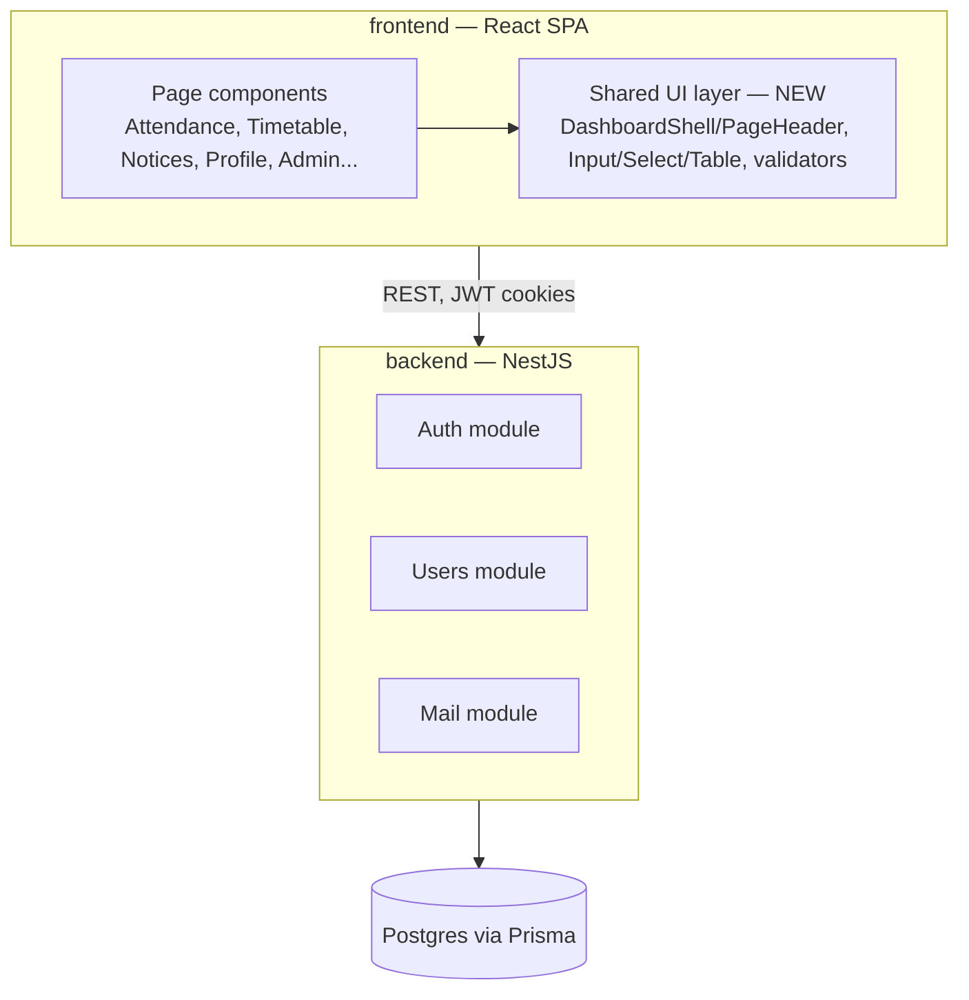

# Plan: Codebase Refactor (Deduplication & Best Practices)

## Tech stack

Only additions — everything else in the existing stack is unchanged.

| Need | Choice | Reason |
|---|---|---|
| Frontend test framework | Vitest + React Testing Library | Vitest is already used by the backend and integrates natively with Vite (the frontend's bundler) — no new test runner to learn |
| Backend lint config | `.oxlintrc.json` (mirroring frontend's) | Backend already has an `oxlint` lint script but no config file, so it currently runs with defaults only |

Unchanged: React 19 + Vite + TypeScript + Tailwind v4 (frontend), NestJS 12 + Prisma 7 + Postgres + JWT auth (backend), oxlint (both).

CI was considered and explicitly dropped from v1 scope (see Decisions log).

## Architecture

The only structural change is a new shared UI layer in the frontend. No backend architecture changes.

## Data model

No changes. Schema stays exactly as-is, since wiring real APIs/DB for the mock-data pages is out of scope for this refactor:

- **User** — id, name, email, passwordHash, role (admin/teacher/student/parent), createdAt, updatedAt
- **RefreshToken** — id, tokenHash, userId, longLived, expiresAt, revokedAt, createdAt
- **PasswordResetToken** — id, tokenHash, userId, expiresAt, usedAt, createdAt

- **Notice** — id, title, description, audience (all/admin/teacher/student/parent), postedById, createdAt, updatedAt

Attendance and timetable remain frontend-only mock data (`frontend/src/data/*.ts`) with no backing tables. Classes and notices are backed by the API.

## Milestones

- **M1 — Shared layout.** Extract a `DashboardShell`/`PageHeader` component (mirroring the existing `AuthShell` pattern) and migrate all 10 pages to use it.
  *See/test: every page renders identically, with far less repeated markup; sign-out works everywhere.*

- **M2 — Shared form primitives + validator.** Extract `Input`/`Select` components and one shared email/password validator utility; replace the two inconsistent regexes currently in `AdminCreatePage.tsx` and `ProfilePage.tsx`.
  *See/test: forms on both pages still validate correctly.*

- **M3 — De-duplicate table/list logic.** Shared rendering for `AttendancePage` ↔ `MyAttendancePage`, and shared grid logic for `TimetablePage` ↔ `MyTimetablePage`.
  *See/test: both page pairs still display the same data, badges, and empty states as before.*

- **M4 — Frontend strict mode.** Enable `strict` in `frontend/tsconfig.app.json`; fix whatever type errors it surfaces.
  *See/test: `tsc -b` passes clean; app still builds and runs.*

- **M5 — Backend hygiene.** Add `.oxlintrc.json` for the backend; add tests for `auth.service` (login, refresh, forgot/reset password).
  *See/test: `npm run lint` and `npm run test` pass in `backend/`, with real auth coverage.*

## Technical risks

| Risk | Impact | Mitigation |
|---|---|---|
| Strict-mode rollout (M4) surfaces many pre-existing type errors | Could expand scope/time beyond initial estimate | Accepted as a known trade-off; fix incrementally, file by file |
| Writing auth tests (M5) requires mocking JWT/bcrypt/email flows | Time-consuming to do properly | Start with critical paths (login, refresh) before edge cases |
| No frontend tests exist yet, so refactoring shared UI (M1-M3) could regress working pages — especially the real auth flow | Could break login/reset-password | Manually verify every page after each milestone; consider a minimal smoke test for the auth flow before touching `AuthShell`-adjacent code |
| No CI to catch regressions automatically (dropped from scope) | Regressions rely on manual verification only | Accepted trade-off per user decision; revisit if pain resurfaces |

## Decisions log

| Decision | Reason |
|---|---|
| Frontend de-duplication (M1-M3) comes before backend/hygiene work (M4-M5) | User's codebase pain point is the duplicated frontend pages; fix the stated problem first |
| CI dropped entirely from v1 scope | User explicitly deprioritized it mid-planning; not a current priority |
| Vitest chosen for frontend tests | Already used by backend; pairs natively with Vite |
| No new backend entities/APIs | Wiring real APIs/DB for mock-data pages is explicitly out of scope (see brainstorm.md) |
| Data model left unchanged | No new features in this refactor, only structural cleanup of existing code |
