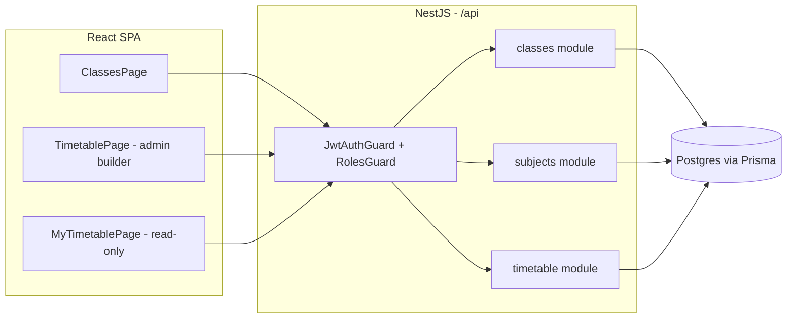

# Plan: Academic Management

## Tech stack

Inherited from the existing app — no new dependencies.

- **Backend:** NestJS 12 modules + Prisma 7 + Postgres — same pattern as the existing `auth`/`users` modules.
- **Frontend:** React 19 + Vite + TS + Tailwind v4 — rewires existing mock pages; no calendar/scheduling library needed since periods are fixed and the week is Monday–Friday.
- **Auth:** reuses the existing JWT (the token payload already carries `role`). Adds a `RolesGuard` + `@Roles()` decorator, which doesn't exist yet.
- **Testing:** Vitest, same as current setup (`npm run test` in both `backend/` and `frontend/`).

## Architecture

**Backend** — new NestJS modules alongside the existing `auth`/`users`:
- `common/guards/roles.guard.ts` + `@Roles()` decorator — shared, reads `role` from the JWT payload, locks admin-only endpoints.
- `classes/` module — Class CRUD, nested Section CRUD, subject-to-class assignment.
- `subjects/` module — global subject catalog CRUD.
- `timetable/` module — weekly timetable entries per section, conflict validation, plus `GET /timetable/me` for teachers/students.

**Frontend** — rewire existing mock pages to call real APIs instead of local state:
- `ClassesPage.tsx` → real class/section/subject data.
- `TimetablePage.tsx` → admin timetable builder, real data.
- `MyTimetablePage.tsx` → teacher/student read-only view, real data.
- `frontend/src/lib/http.ts` currently only has `get`/`post` — needs `put`/`patch`/`delete` added.

**Flow:** React SPA → `/api/...` (Vite proxy in dev) → NestJS controllers → Prisma → Postgres. All writes go through `JwtAuthGuard` + `RolesGuard` (admin-only); reads are open to any authenticated role, scoped to the caller for "my timetable".



## Data model

```prisma
model Class {
  id        String   @id @default(cuid())
  name      String   @unique
  createdAt DateTime @default(now())
  updatedAt DateTime @updatedAt

  sections      Section[]
  classSubjects ClassSubject[]
}

model Section {
  id             String   @id @default(cuid())
  name           String
  classId        String
  class          Class    @relation(fields: [classId], references: [id], onDelete: Cascade)
  classTeacherId String?
  classTeacher   User?    @relation("SectionClassTeacher", fields: [classTeacherId], references: [id])
  createdAt      DateTime @default(now())
  updatedAt      DateTime @updatedAt

  students         User[]           @relation("StudentSection")
  timetableEntries TimetableEntry[]

  @@unique([classId, name])
}

model Subject {
  id        String   @id @default(cuid())
  name      String   @unique
  createdAt DateTime @default(now())

  classSubjects ClassSubject[]
}

model ClassSubject {
  id        String   @id @default(cuid())
  classId   String
  class     Class    @relation(fields: [classId], references: [id], onDelete: Cascade)
  subjectId String
  subject   Subject  @relation(fields: [subjectId], references: [id])
  teacherId String?
  teacher   User?    @relation("SubjectTeacher", fields: [teacherId], references: [id])

  @@unique([classId, subjectId])
}

model Period {
  id        String  @id @default(cuid())
  order     Int     @unique
  startTime String
  endTime   String
  isBreak   Boolean @default(false)
  label     String?

  timetableEntries TimetableEntry[]
}

enum DayOfWeek {
  mon
  tue
  wed
  thu
  fri
}

model TimetableEntry {
  id        String    @id @default(cuid())
  sectionId String
  section   Section   @relation(fields: [sectionId], references: [id], onDelete: Cascade)
  periodId  String
  period    Period    @relation(fields: [periodId], references: [id])
  dayOfWeek DayOfWeek
  subjectId String
  subject   Subject   @relation(fields: [subjectId], references: [id])
  teacherId String
  teacher   User      @relation("EntryTeacher", fields: [teacherId], references: [id])

  @@unique([sectionId, periodId, dayOfWeek])
  @@unique([teacherId, periodId, dayOfWeek])
}
```

`User` gets one addition: a nullable `sectionId` (+ relation `"StudentSection"`) so a student account can be linked to the section they belong to. This isn't full roster/enrollment management (that stays out of scope) — it's the minimal field needed for "students view their timetable" to work. Admin sets it from the Sections screen.

`Period` is seeded once via a migration seed script (fixed 8:00 AM–1:00 PM schedule, periods + breaks) — not user-editable in v1.

## Milestones

**M1 — Foundation + Class management**
- Add `RolesGuard` + `@Roles()` decorator (backend)
- `Class` model + CRUD API
- Rewire `ClassesPage` class list (create/rename/delete) to real data
- Test: log in as admin, create/edit/delete a class, refresh — it persists. Log in as teacher/student, confirm write attempts are blocked.

**M2 — Sections + Subjects**
- `Section`, `Subject`, `ClassSubject` models + CRUD APIs
- Full `ClassesPage` wired: sections within a class, subject catalog, one-teacher-per-subject assignment
- Add `sectionId` to `User`, simple admin UI to assign a student to a section
- Test: create sections under a class, assign subjects + teachers, assign a student user to a section.

**M3 — Timetable builder**
- `Period` model + seed data (8:00–1:00, fixed)
- `TimetableEntry` model + CRUD API with conflict validation (clear error message backed by the DB unique constraint)
- Rewire `TimetablePage` (admin builder) to real data
- Test: build a weekly timetable for a section, try to double-book a teacher across two sections at the same slot, see it rejected.

**M4 — Read-only views**
- `GET /timetable/me` endpoint
- Rewire `MyTimetablePage` for teachers (their taught slots) and students (their section's timetable)
- Test: log in as a teacher and a student, each sees only their own schedule, no edit controls visible.

## Technical risks

| Risk | Mitigation |
|---|---|
| No `RolesGuard` exists today — admin-only enforcement is currently frontend-only | Build and test the guard in M1 before any other write endpoint ships |
| Teacher double-booking conflict logic | Enforced at two levels: DB unique constraint (`teacherId` + `periodId` + `dayOfWeek`) as the source of truth, plus a service-layer check for a clear user-facing error message |
| Linking students to sections isn't in the original brainstorm scope | Scoped to the minimum: one nullable `sectionId` field on `User`, set by admin from the Sections screen — no roster/enrollment workflow built |
| Rewiring mock frontend pages while also improving UI/flow | Each milestone rewires one page at a time against real data, so regressions are caught incrementally rather than in one large rewrite |

## Decisions log

| Decision | Reason |
|---|---|
| Reuse existing NestJS/Prisma/React stack, no new libraries | Fixed periods + Mon–Fri schedule don't need a scheduling library; staying consistent with the existing codebase |
| One teacher per subject per class (not multiple) | Confirmed with user during brainstorm |
| Fixed, school-wide periods (not per-class configurable) | Confirmed with user during brainstorm; simplifies `Period` to one seeded table |
| School day is 8:00 AM–1:00 PM, Monday–Friday | Confirmed with user during brainstorm |
| Period seed: 6 × 45-min periods + one 30-min Recess (10:15–10:45) | Confirmed with user during /use-cases; resolves the brainstorm's open question |
| Conflict detection is automatic, not just advisory | Confirmed with user during brainstorm; implemented via DB unique constraint |
| Add nullable `User.sectionId` for students | Necessary gap found during planning — without it, students have no way to be linked to a timetable |
| Single school, no multi-tenant data model | Confirmed with user during brainstorm |
| Rework mock UI/flow, not just reskin | Confirmed with user during brainstorm |
