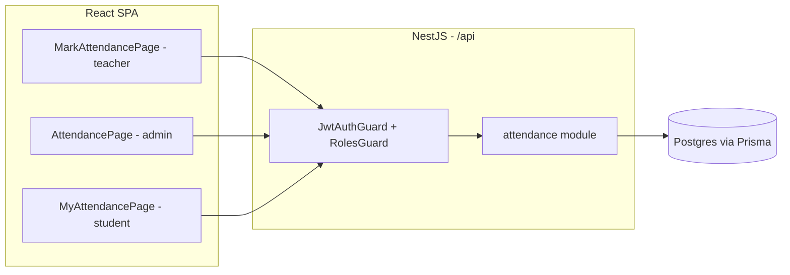

# Plan: Attendance Management

## Tech stack

No new dependencies — reuse the existing stack.

- **Backend:** NestJS 12 modules + Prisma 7 + Postgres — same pattern as the existing `classes`/`timetable` modules.
- **Frontend:** React 19 + Vite + TS + Tailwind v4 — rewires existing mock pages (`MarkAttendancePage`, `AttendancePage`, `MyAttendancePage`) to call real APIs instead of local state.
- **Auth:** reuses the existing JWT + `RolesGuard`/`@Roles()` decorator (no new guard needed).
- **Testing:** Vitest, same as current setup (`npm run test` in both `backend/` and `frontend/`).

## Architecture

**Backend** — new `attendance` NestJS module alongside `classes`/`timetable`/`subjects`:
- `POST/PUT /attendance/sections/:sectionId/days/:date` — the section's class teacher submits or edits attendance. Guarded: caller must equal `section.classTeacherId`, and `date` must be today's server date (no backfilling past/future days).
- `PATCH /attendance/sections/:sectionId/days/:date` — admin-only edit of any day's attendance. Each changed student status writes an `AttendanceEdit` audit row (old → new, who, when). No reason/comment required.
- `GET /attendance/sections/:sectionId/days/:date` — fetch one day's session (entries + edit log). Accessible to the section's class teacher (own section) and admin (any section).
- `GET /attendance/me?month=YYYY-MM` — the logged-in student's own attendance for a month.
- `GET /attendance/reports/daily?date=` — present/absent/leave counts per section for a date.
- `GET /attendance/reports/monthly?sectionId=&month=` — present/absent/leave/markedDays/percentage per student in a section for a month.

**Key design decision:** rather than a scheduled midnight job to "lock" attendance, locking is computed at request time: a session is locked simply if its `date` isn't today. This gives identical user-facing behavior (teacher can edit same-day, locked after) without a background job that could fail silently — removing that risk entirely. Admin edits always go through the audited `PATCH`, regardless of lock state.

**Frontend** — rewire the three existing mock pages (already fully built against local mock state in a prior pass) to real API calls:
- `MarkAttendancePage.tsx` (teacher) → real submit/edit for today's attendance. Also gets a small behavior fix: the current mock locks immediately on submit with no way back in — it needs a re-edit affordance for the same day, to match "teacher can edit before lock."
- `AttendancePage.tsx` (admin) → real browse/edit for any section/day, real daily summary table, real monthly % table.
- `MyAttendancePage.tsx` (student) → real monthly attendance + stats for the logged-in student. The parent branch stays an unwired placeholder (parent access is out of scope for v1 — see `docs/brainstorm.md`).
- `frontend/src/lib/http.ts` already has `get`/`post`/`patch`/`put`/`delete` — no changes needed there.

**Flow:** React SPA → `/api/...` (Vite proxy in dev) → NestJS controllers → Prisma → Postgres. All writes go through `JwtAuthGuard` + section/role checks; reads are scoped to the caller (teacher → own section, student → own records, admin → everything).



## Data model

```prisma
enum AttendanceStatus {
  present
  absent
  leave
}

model AttendanceSession {
  id            String           @id @default(cuid())
  sectionId     String
  section       Section          @relation(fields: [sectionId], references: [id], onDelete: Cascade)
  date          DateTime         @db.Date
  submittedById String
  submittedBy   User             @relation("AttendanceSubmitter", fields: [submittedById], references: [id])
  submittedAt   DateTime         @default(now())
  updatedAt     DateTime         @updatedAt

  entries AttendanceEntry[]
  edits   AttendanceEdit[]

  @@unique([sectionId, date])
}

model AttendanceEntry {
  id        String            @id @default(cuid())
  sessionId String
  session   AttendanceSession @relation(fields: [sessionId], references: [id], onDelete: Cascade)
  studentId String
  student   User              @relation("StudentAttendance", fields: [studentId], references: [id], onDelete: Cascade)
  status    AttendanceStatus

  @@unique([sessionId, studentId])
}

model AttendanceEdit {
  id         String            @id @default(cuid())
  sessionId  String
  session    AttendanceSession @relation(fields: [sessionId], references: [id], onDelete: Cascade)
  studentId  String
  student    User              @relation("AttendanceEditedStudent", fields: [studentId], references: [id])
  fromStatus AttendanceStatus
  toStatus   AttendanceStatus
  editedById String
  editedBy   User              @relation("AttendanceEditedBy", fields: [editedById], references: [id])
  editedAt   DateTime          @default(now())
}
```

One `AttendanceSession` per section+day (matches "locked after submission" being a whole-day concept), with one `AttendanceEntry` row per enrolled student — mirrors the existing frontend mock's `AttendanceRecord`/`entries` shape closely, minimizing rework. "Locked" isn't a stored column — it's `session.date !== today`, computed at request time. No changes needed to `Section` or `User` — `classTeacherId` and `sectionId` already exist and do the job.

## Milestones

**M1 — Mark & same-day edit (teacher flow)**
- `AttendanceSession` + `AttendanceEntry` models + migration
- `POST/PUT` + `GET` endpoints for a section+day, guarded to the section's class teacher, today-only
- Rewire `MarkAttendancePage` to real data, with re-edit enabled until midnight
- Test: log in as a section's class teacher, submit attendance, edit it again same day, see it persist. Log in as a different teacher, confirm blocked from that section.

**M2 — Admin browse & edit + audit log**
- `AttendanceEdit` model
- Admin-only `PATCH` endpoint with audit logging; `GET` usable by admin for any section/day
- Rewire `AttendancePage`'s "Browse & edit" section to real data
- Test: log in as admin, open a past (locked) day, change a student's status, see the edit log entry with old → new value.

**M3 — Reports**
- `GET /attendance/reports/daily` and `GET /attendance/reports/monthly` endpoints
- Rewire `AttendancePage`'s daily summary and monthly % tables to real data
- Test: log in as admin, view daily summary across sections and monthly % per student.

**M4 — Student view**
- `GET /attendance/me` endpoint
- Rewire `MyAttendancePage` for the student role to real data (parent branch stays an unwired placeholder)
- Test: log in as a student, see own attendance history and monthly %; confirm another student's data isn't visible.

## Technical risks

| Risk | Mitigation |
|---|---|
| Computing "locked" from a date comparison needs the right calendar-day semantics | Compare `session.date` to the server's current local date (consistent with existing date-string patterns elsewhere in the app); single-school/single-timezone deployment, so no timezone-conversion complexity needed |
| Class-teacher guard must reject other teachers (e.g. subject teachers for that section) | `Section.classTeacherId` already exists and is distinct from `ClassSubject.teacherId`; guard compares `section.classTeacherId === req.user.id` |
| Existing mock `MarkAttendancePage` locks immediately with no re-edit option, which contradicts the confirmed "teacher can edit until midnight" behavior | M1 includes a UI fix (re-edit affordance), not just data-wiring |
| Parent role has no student link (deferred per brainstorm) | `MyAttendancePage`'s parent branch stays a non-wired placeholder for v1; revisit once a parent–student relationship is built |
| All-students-required submission could reject legitimate partial saves | Frontend already defaults every roster student to "present" before submit, so every submission is complete by construction; backend validates the full roster is covered |

## Decisions log

| Decision | Reason |
|---|---|
| Reuse existing NestJS/Prisma/React stack, no new libraries | Consistent with the existing codebase; no new technical surface needed |
| No scheduled/cron job for midnight lock — "locked" computed from date comparison instead | Simpler, removes a background-job failure risk, behaviorally identical to an auto-lock |
| One `AttendanceSession` per section+day with child `AttendanceEntry` rows, not one row per student | Matches "locked after submission" as a whole-day concept and mirrors the existing frontend mock's data shape |
| Teacher same-day edits are not logged; only Admin edits to a locked/past day are logged | Confirmed during brainstorm |
| No reason/comment required on Admin edits | Confirmed during brainstorm |
| `MarkAttendancePage` gets a small behavior change (re-edit before midnight), beyond pure data-wiring | Necessary gap found during planning — the existing mock's "lock immediately" behavior contradicted the agreed product behavior |
| Parent view/access and academic calendar/holidays are out of scope for v1 | Confirmed during brainstorm |
| Reuse `Section.classTeacherId` and `User.sectionId` as-is | Both already exist from the Academic Management feature and fully cover this feature's needs |
